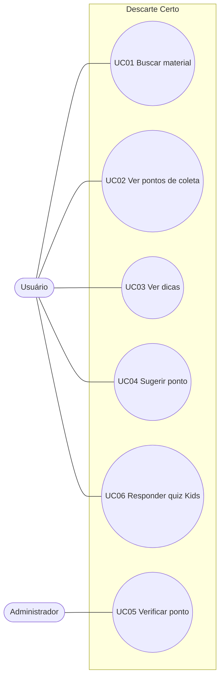
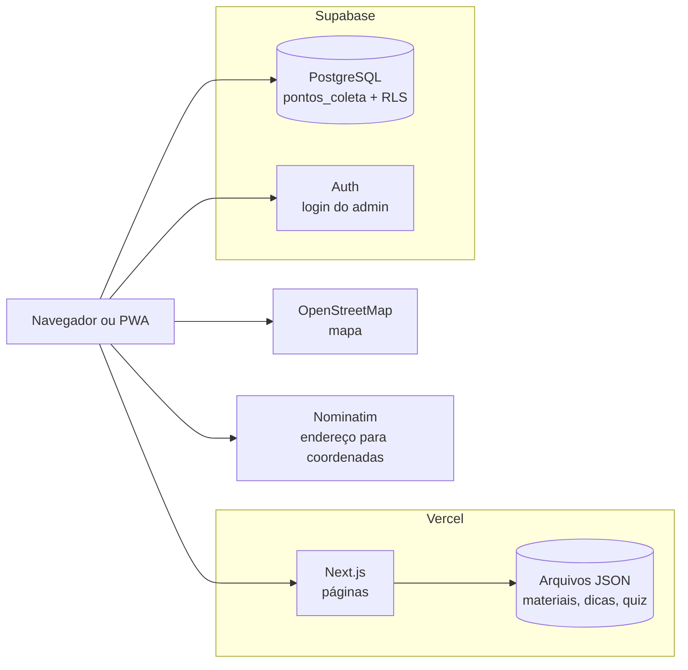
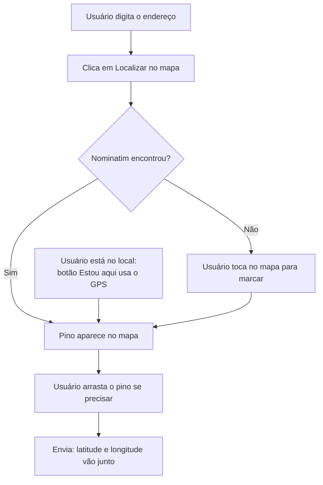
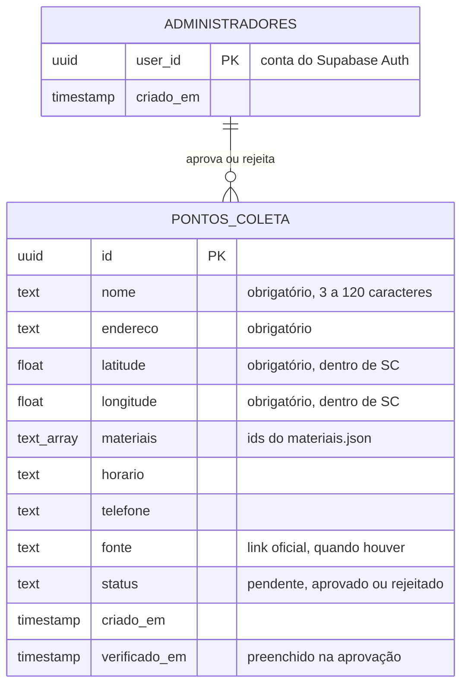
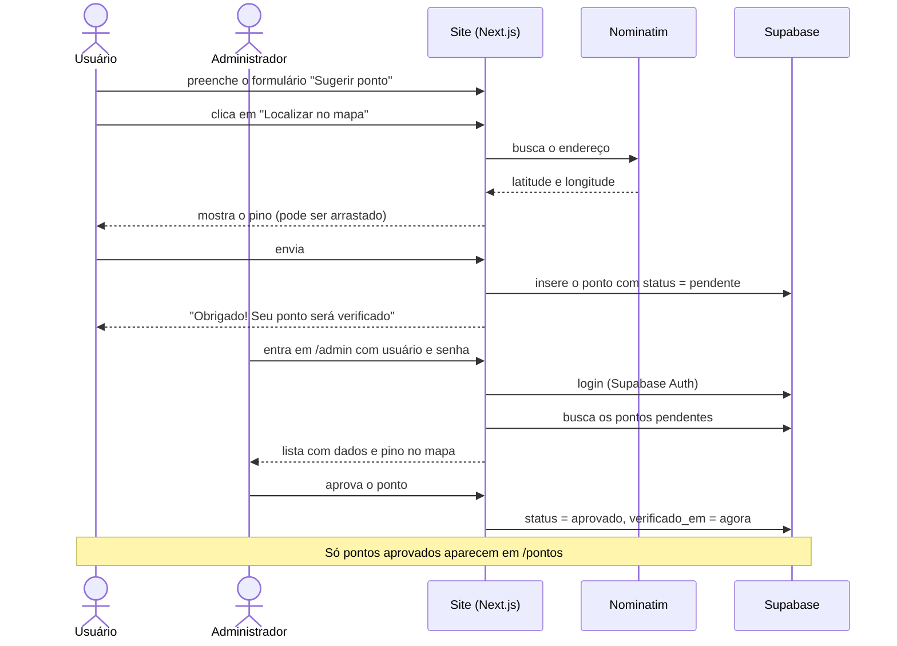

# Diagramas

Os diagramas usam [Mermaid](https://mermaid.js.org/) e aparecem renderizados no GitHub.

## 1. Casos de uso



## 2. Arquitetura

O Next.js gera as páginas e o navegador conversa direto com o Supabase usando a chave pública (anon key). A proteção dos dados fica nas regras do banco (RLS), por isso não há API Routes.



| Parte | Tecnologia | Por quê |
|---|---|---|
| Frontend | Next.js 16 (App Router) + TypeScript + Tailwind CSS v4 | Páginas estáticas e simples; tema escuro por variáveis CSS que seguem a preferência do aparelho. |
| Hospedagem | Vercel (plano gratuito) | Deploy automático a cada `git push`. |
| Conteúdo fixo | Arquivos JSON no repositório | Materiais, dicas e quiz mudam pouco e não precisam de banco. |
| Banco e login | Supabase (plano gratuito) | Pontos de coleta e login do admin por nome de usuário e senha. |
| Mapa | Leaflet + OpenStreetMap | Gratuito, sem chave de API. Carregado só no navegador (`dynamic` com `ssr: false`). |
| Endereço → coordenadas | Nominatim (OpenStreetMap) | Gratuito, sem chave. Uma busca por clique em "Localizar no mapa", respeitando o limite de 1 requisição por segundo. |
| PWA | `app/manifest.ts` do Next.js | Torna o site instalável. Sem modo offline no MVP. |
| Testes e CI | Vitest, Playwright, axe e GitHub Actions | Cada push roda lint, tipos, testes unitários, build, testes de ponta a ponta, acessibilidade e as regras de segurança do banco. |

## 3. Como o ponto sugerido ganha coordenadas (RN04)

Quem sugere define a posição; o administrador só confere o pino.



## 4. Modelo de dados

Apenas os pontos de coleta ficam no Supabase. Os pontos oficiais (ecopontos da Comcap etc.) entram por um arquivo `supabase/seed.sql` já com status `aprovado`.



No banco, `materiais` é do tipo `text[]` (lista de textos).

**Segurança (RLS e configurações):** o script completo está em [`supabase/schema.sql`](../../supabase/schema.sql).

| Quem | Pode fazer |
|---|---|
| Público (anon) | Ler só pontos com `status = 'aprovado'`. Inserir só com `status = 'pendente'` (o público nem tem permissão na coluna `status`). |
| Usuário logado que não é admin | O mesmo que o público. |
| Admin (está na tabela `administradores`) | Ler todos os pontos, aprovar, rejeitar e apagar. |

- A verificação de admin usa a função `privado.eh_admin()`, num schema que não fica exposto pela API.
- O formulário envia com `insert` **sem** `.select()`, porque o público não pode ler pontos pendentes.
- A chave `service_role` nunca vai para o código do site nem para variáveis `NEXT_PUBLIC_`.
- O banco valida tamanhos, campos obrigatórios, a região (SC) e a lista de materiais.
- O formulário tem um campo invisível (*honeypot*) contra robôs de spam.
- Testes: `tests/seguranca/rls.test.ts` (público, contra o banco real) e `supabase/testes-rls-admin.sql` (admin, com rollback).

Estrutura de `materiais.json` (exemplo):

```json
{
  "id": "pilhas",
  "nome": "Pilhas",
  "categoria": "Pilhas e baterias",
  "riscos": ["Podem vazar substâncias nocivas se danificadas."],
  "cuidados": ["Guarde em pote fechado, longe de calor e umidade."],
  "destino": "Ponto de logística reversa que receba pilhas.",
  "fonte": "https://greeneletron.org.br/perguntas-frequentes/",
  "revisado_em": "2026-11"
}
```

## 5. Sequência: sugerir e verificar ponto (RF04)


